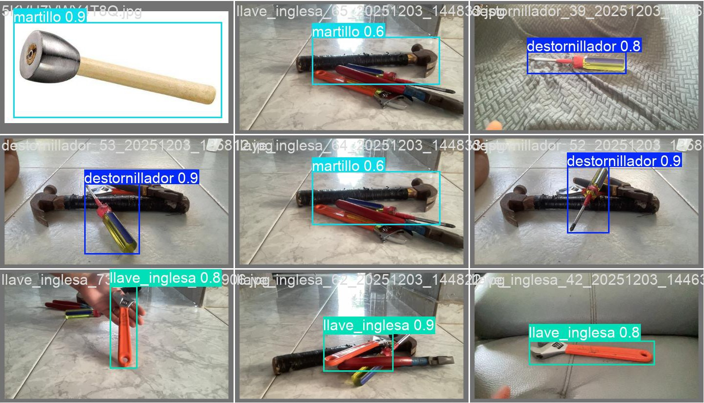
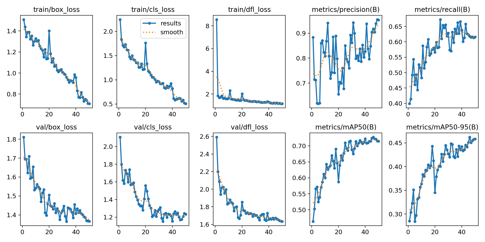

# Detección e inventario de herramientas con visión artificial (YOLOv8)

> **EN:** Real-time tool detection with a custom-trained YOLOv8 model, integrated into a desktop inventory app (Tkinter + SQLite).

En un taller, llevar el control de las herramientas a mano genera extravíos, errores y tiempo perdido buscándolas. Este prototipo reconoce con la cámara qué herramienta se le muestra y lleva el inventario en una base de datos.



## Qué hace

- **Detección en tiempo real** de 4 clases: destornillador, martillo, pinza y llave inglesa. Muestra la clase y la confianza de cada detección.
- **Aplicación de escritorio** (Tkinter) para iniciar o detener la cámara, agregar al inventario lo que se detectó, registrar herramientas a mano, actualizar cantidades y eliminar registros.
- **Base de datos SQLite** con nombre, clase YOLO, cantidad, descripción y estado de cada herramienta.

## Cómo se construyó el modelo

1. **Dataset propio de 519 imágenes** (417 de entrenamiento y 102 de validación). Combina fotos tomadas con un script de captura y fotos de referencia.
2. **Etiquetado asistido.** Un script hace un primer etiquetado automático y otros dos verifican las etiquetas y la estructura del dataset antes de entrenar.
3. **Fine-tuning de YOLOv8n** (Ultralytics) a 640 px.

| Métrica (validación, mejor época) | Valor |
|---|---|
| mAP@50 | **0.727** |
| mAP@50-95 | 0.462 |
| Precisión | 0.918 |
| Recall | 0.618 |

**Cómo leer estos números.** La precisión es alta: casi no hay falsas alarmas. El recall es moderado: todavía se escapan algunas herramientas. La mejora más directa sería ampliar y balancear el dataset.



## Tecnologías

Python · Ultralytics YOLOv8 · PyTorch · OpenCV · Tkinter · Pillow · SQLite

## Estructura

```
app_taller.py                 aplicación principal: cámara + detección + inventario
iniciar_sistema.py            menú de arranque
database_manager.py           acceso a la base SQLite
setup_database.py             crea la base de datos inicial
dataset.yaml                  configuración del dataset (4 clases)
runs/detect/.../best.pt       pesos del modelo entrenado
entrenamiento/                scripts de entrenamiento, fine-tuning y prueba del modelo
herramientas_desarrollo/      captura de fotos, auto-etiquetado, división train/val y verificación
resultados/                   métricas, curvas y matriz de confusión
```

`entrenamiento/comparacion_resnet50_imagenet.py` es un experimento aparte. Clasifica fotogramas con un ResNet50 preentrenado en ImageNet, sin entrenamiento propio, para compararlo con el detector entrenado.

## Ejecutar

```bash
pip install -r requirements.txt
python setup_database.py     # crea herramientas.db
python app_taller.py         # requiere una cámara conectada
```

Los scripts de `entrenamiento/` y `herramientas_desarrollo/` se ejecutan desde la raíz del repositorio. Las imágenes del dataset no se incluyen.

## Autores

**César De La Rosa** y **Dereck Moreno.** Proyecto final de *Tópicos Especiales I: Visión Artificial*, Universidad Tecnológica de Panamá (FISC), II semestre de 2025.
